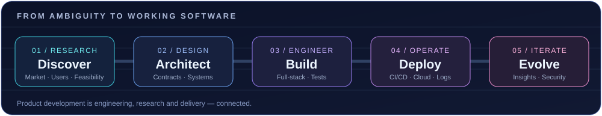
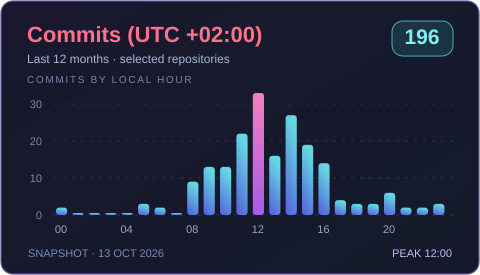

 

---

### `> whoami`

I'm **Takunda Cliff Jaure** — a software engineer in **Harare, Zimbabwe** working at the intersection of **full-stack engineering, DevOps, product development, cloud architecture and AI-enabled systems**.

I work through the complete product lifecycle: **discovery → research → requirements → architecture → development → deployment → iteration**. I care about building things that solve real problems, especially in African markets.

- **Currently building:** hospitality and business software, plus **Nexora**, an AI-powered knowledge and productivity workspace.
- **Core focus:** robust TypeScript applications, reliable infrastructure, reusable architecture and practical product research.
- **Growing into:** AI systems integration, agent tooling, secure-by-design applications and cybersecurity/AI governance.
- **Available for:** scoped remote engineering engagements, deployment automation and technical collaboration.

 

  

### `// Engineering stack`

**APPLICATIONS & APIs**

**DATA & APPLICATION ARCHITECTURE**

**CLOUD · DEVOPS · OBSERVABILITY**

**DESIGN · DELIVERY**

> **Beyond the stack:** market and competitor research · stakeholder discovery · feasibility studies · PRDs/SRS · roadmap planning · domain modeling · API contracts · technical documentation · QA and product lifecycle management.

### `// Systems & featured work`

| System | Focus | Stage |
| :--- | :--- | :--- |
| **Nexora** | AI-assisted notes, projects and calendar; **pgvector retrieval, MCP integration, OAuth, fine-grained authorization, Yjs collaboration** | Personal product · active development |
| **ARMS / ARMS Lite** | Hospitality and property operations; role-based interfaces, booking flows, mobile-first experience | Professional product work |
| **RELAY by AADS** | Multi-brand outreach; queue processing, quota enforcement, idempotent campaigns, templating and delivery webhooks | Internal application |
| **EngageX** | Streaming AI engagement scoring, ML lifecycle, observability and security architecture | Conceptual architecture / POC |
| **[AIIVR Demo](https://github.com/Cliff263/AIIVR-Demo)** | Real-time Next.js, Socket.IO and Prisma workflows | Public demo |
| **[Shiny Couscous](https://github.com/Cliff263/shiny-couscous)** | Next.js / TypeScript ecommerce with Prisma and payments integration | Public portfolio project |
| **[Drones Dispatch](https://github.com/Cliff263/zb-drones)** | Java / Spring Boot REST service for drone fleet and medical payloads | Public backend project |

Selected professional repositories are private. Descriptions communicate public-facing competencies without publishing proprietary implementation details. Emerging research and planned infrastructure are not presented as shipped systems.

### `// Current technical direction`

<table>
<tr><td width="50%" valign="top">

**<code>01 / SYSTEMS ENGINEERING</code>**

- Type-safe APIs and maintainable full-stack apps
- PostgreSQL-first domain models
- Performance, concurrency and resilience
- Docker, CI/CD, reverse proxies and monitoring

</td><td width="50%" valign="top">

**<code>02 / INTELLIGENT & SECURE SOFTWARE</code>**

- MCP, model APIs and retrieval with pgvector
- OAuth scopes, access control and data privacy
- AI security and governance research
- Product discovery and architecture-led delivery

</td></tr>
</table>

### `// Areas of Interest`

- **Product management & development lifecycle:** Discovery, feasibility, user research, SRS/PRDs, prioritization, roadmaps and technical delivery.
- **Full-stack software engineering:** TypeScript, Next.js, backend APIs, reusable component systems and scalable architectures.
- **Cloud-native infrastructure & DevOps:** AWS, Hetzner, containerization, Kubernetes, CI/CD, GitOps, monitoring and backups.
- **Systems architecture:** Multi-tenant platforms, integration contracts, resilient services and performance engineering.
- **Artificial intelligence & agentic systems:** LLM integration, tool-use protocols, Model Context Protocol (MCP) and AI-enabled products.
- **Retrieval & data engineering:** Vector embeddings, pgvector, semantic search, RAG and data-intensive applications.
- **Cybersecurity & AI governance:** OAuth, secure-by-design software, cloud security, privacy, authorization and emerging AI-specific threats.
- **AI infrastructure:** GPU deployment architectures, model serving, operational reliability and deployment cost optimization.
- **Real-time & concurrent systems:** WebSockets, collaborative editing, event-driven applications and Rust.
- **Fintech & payment systems:** Transaction integrity, distributed payment ledgers and secure financial integrations.
- **Hospitality technology:** Property management, guest experiences, distribution, marketplaces and hotel operations.
- **Software products for African markets:** Practical, affordable platforms informed by local constraints and user research.

### `// GitHub Statistics`

**Profile Overview**

 

**Languages**

<table>
<tr>
<th width="50%">Repositories per Language</th>
<th width="50%">Most Committed Language</th>
</tr>
<tr>
<td align="center"></td>
<td align="center"></td>
</tr>
</table>

**Activity**

<table>
<tr>
<th width="50%">GitHub Statistics</th>
<th width="50%">Productive Time · UTC+02:00</th>
</tr>
<tr>
<td align="center"></td>
<td align="center"></td>
</tr>
</table>

Most cards use an external statistics provider and can be temporarily rate-limited. The <b>Productive Time</b> chart is now a reliable, repository-hosted snapshot (13 Oct 2026) of 196 attributed commits in selected repositories, including private work, aggregated without exposing private code or commit details. It is not live; GitHub commit timestamps are not a measure of hours worked.

### `// Work with me`

**Need help shipping a web app, improving an API or making deployments repeatable?** I can help with TypeScript / Next.js development, cloud architecture reviews, CI/CD, Docker deployments, observability and product-to-engineering planning.

 

SirCliff@IsodyneTechnologies.

